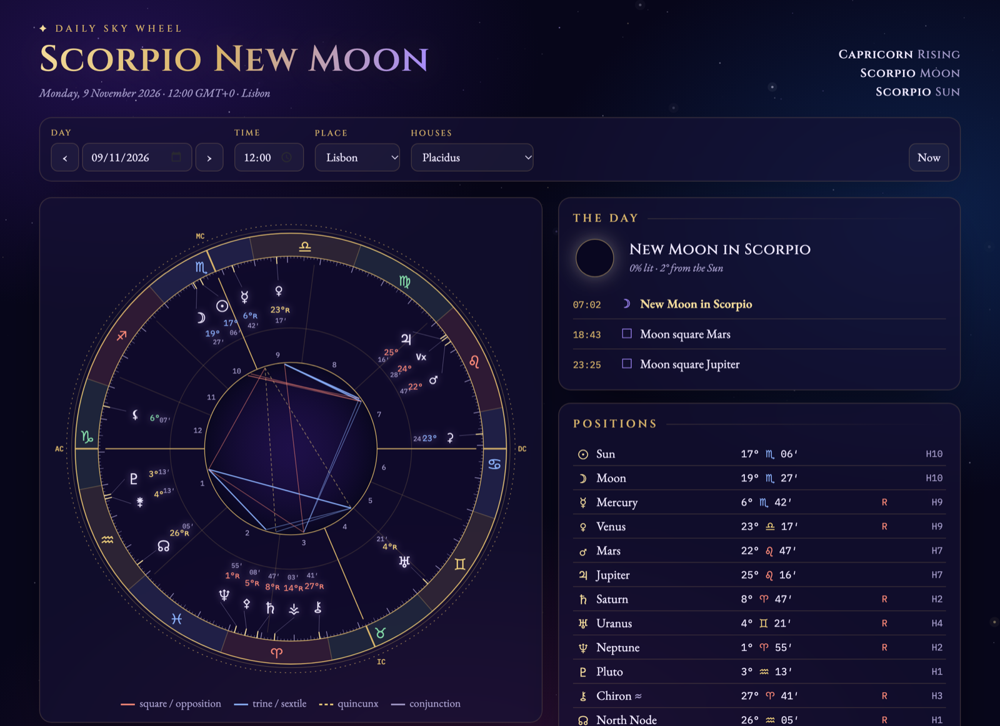

<div align="center">


# Daily Sky Wheel

**The astrology chart for any day and place, drawn live in your browser.**

♈ ♉ ♊ ♋ ♌ ♍ ♎ ♏ ♐ ♑ ♒ ♓

[](https://alex-quiterio.github.io/daily-sky-wheel/)
<br>
[](https://github.com/alex-quiterio/daily-sky-wheel/actions/workflows/test.yml)


<br>

<a href="https://alex-quiterio.github.io/daily-sky-wheel/"></a>

</div>

<br>

## ☽ What it shows

Pick a day, a time and a place and the sky comes back as a chart.

| | |
|---|---|
| **☉ The wheel** | Sun to Pluto, Chiron, the North Node, Lilith, Ceres, Pallas, Juno, Vesta and the Vertex. The signs are coloured by element, and aspect lines run through the centre. Planets that sit close together are fanned out so their labels don't overlap. |
| **☾ The day** | The Moon's phase, then everything that happens between midnight and midnight local time: New and Full Moons, quarters, sign changes, stations and exact aspects, each with its time to the minute. Click any of them to recast the wheel for that moment. |
| **✦ Year ahead** | The next 12 months from today: solar and lunar eclipses, retrograde and direct stations, sign changes of Jupiter through Pluto, Chiron and the North Node, exact aspects between the outer planets, Venus star points, and the equinoxes and solstices. Filter by kind, and click any entry to cast the chart for that moment. |
| **中 Chinese tab** | Four Pillars (BaZi) for the moment: stems, branches, hidden stems and Ten Gods around the Day Master; the Five Elements balance; the Chinese lunar date with leap months; the year's animal (turning at Chinese New Year); the current and next solar term; the day's clash; and a wheel of the twelve animals marking the year, month, day and hour. Add `view=chinese` to a link to open on it. |
| **✶ Positions** | Degree, sign and minute for every body, with retrograde flags and the house each one falls in. |
| **△ Balance and patterns** | Counts by element and mode, the chart ruler, and any Yod, T-square, Grand Trine or stellium. |
| **⌂ Houses** | Placidus, Whole sign, Equal, or Natural (Aries on the 1st), switched from the toggle above the wheel. |
| **✧ Hover anything** | Every symbol has a tooltip. **Houses** open with a plain-language line on what that house covers, for anyone new to astrology. **Planets** show position to the arcsecond, house, daily motion, latitude, declination (flagged when out of bounds), dignity, the houses they rule, antiscia, and each aspect with its orb and whether it's applying or separating. **Signs** show element, mode, polarity, rulers, exaltation, detriment and fall, and which cusps and bodies fall in them. **Houses** show the cusp, size, the cusp ruler and where it sits, interceptions and the bodies inside. **Angles and aspect lines** have their own details. Hovering a planet lights up its aspects. Click or tap a symbol to pin its tooltip, and press Esc to close it. |

**My location** uses your device's position (the browser asks first). The **i** next to the house toggle explains all twelve houses, and hovering a house system explains how it divides the chart.

Move through the days with **‹ ›** or the arrow keys. **Now** casts the chart for this minute in your own time zone, picked up from the browser.

## ☾ Install it as an app

In Chrome or Edge, click **Install app** on the page, or use the install icon in the address bar. It opens in its own window with the logo as its icon, and works offline once it has loaded. On iPhone and iPad, use Safari's **Share → Add to Home Screen**.

## ⚹ Link to any moment

Add the date, time and place to the URL and the page opens on that chart. Once a link has parameters, the address keeps up with the form as you change it, and **Copy link** copies it for you.

```
?date=2026-11-09&time=02:02&place=new-york&houses=natural
?date=2026-03-20&time=14:30&lat=44.49&lon=11.34&tz=Europe/Rome
?place=bologna&time=now
```

| Parameter | Format | Notes |
|---|---|---|
| `date` | `YYYY-MM-DD` or `today` | |
| `time` | `HH:MM`, `HHMM` or `now` | Local time at the place. `now` also sets today's date. |
| `place` | a preset name | Any case, with or without accents, hyphens or spaces, e.g. `new-york`, `Francavilla al Mare`, `francavilla-al-mare` |
| `lat`, `lon` | decimal degrees | For places not in the list. North and east are positive. |
| `tz` | IANA zone, e.g. `Europe/Rome` | Used with `lat`/`lon`. Defaults to your browser's zone. |
| `houses` | `placidus`, `whole`, `equal`, `natural` | |
| `view` | `western` or `chinese` | Which tab opens |

If part of a link can't be read, the page says which part and uses its default for that field.

## ✦ Start

It's a static page with no build step.

```sh
git clone https://github.com/alex-quiterio/daily-sky-wheel.git
cd daily-sky-wheel
npm start            # → http://localhost:3000
```

Opening `index.html` directly works too.

## ☿ Proven against a real chart

The calculations are checked against a reference chart cast in desktop astrology software: the **Scorpio New Moon of 9 November 2026, 2:02 AM EST, New York**.

```sh
npm install && npm test
```

All checks pass:

- every body's degree, sign and retrograde flag
- the Ascendant, Midheaven and Vertex
- the Placidus cusps
- the **Yod to Mercury** in that chart
- the New Moon time, to the minute
- Mercury stationing retrograde on 24 October 2026
- the 2027 eclipses, stations and ingresses in the year ahead
- Chinese New Year from 2020 to 2034 (including the tricky 2033), the 2020, 2023 and 2025 leap months, and Four Pillars for 1 Jan 2000

GitHub Actions runs the tests on every push.

## ♄ How it works

```
index.html         the page
src/core.js        positions, houses, Ascendant / MC / Vertex
src/events.js      aspects, patterns, element balance, Moon phase, the day's events, the year ahead
src/chinese.js     Four Pillars, solar terms, Chinese lunar calendar
src/app.js         controls, time zones, the SVG wheel
src/stars.js       the twinkling sky behind it all
src/styles.css     the night theme
assets/logo.svg    the logo, also the browser tab icon
assets/icons/      app icons
manifest.webmanifest, sw.js   install as an app, work offline
```

- **Planets** come from [Astronomy Engine](https://github.com/cosinekitty/astronomy) (MIT), accurate to well under an arcminute.
- **Houses and angles** are computed from sidereal time and the true obliquity of the ecliptic.
- **The day's events** are found by sampling the sky every hour, then bisecting each crossing to within 30 seconds.
- **Time zones** use the browser's own `Intl` database, so daylight-saving changes come out right.

## ⚷ Accuracy

| Bodies | Method | Accuracy |
|---|---|---|
| Sun to Pluto | Astronomy Engine (VSOP87, ELP) | < 1′ |
| True Node, mean Lilith | Meeus' series | a few arcminutes |
| Chiron, Ceres, Pallas, Juno, Vesta ≈ | Keplerian elements tuned to the reference chart | a few arcminutes over 2024–2029, drifting outside that |

Placidus falls back to Equal houses above 66° latitude. There's no city search, because the page makes no network calls. A place outside the preset list goes in as custom latitude, longitude and time zone.

<div align="center">
<br>

☉ ☽ ☿ ♀ ♂ ♃ ♄ ♅ ♆ ♇

<sub>Made with Claude Code.</sub>

</div>
